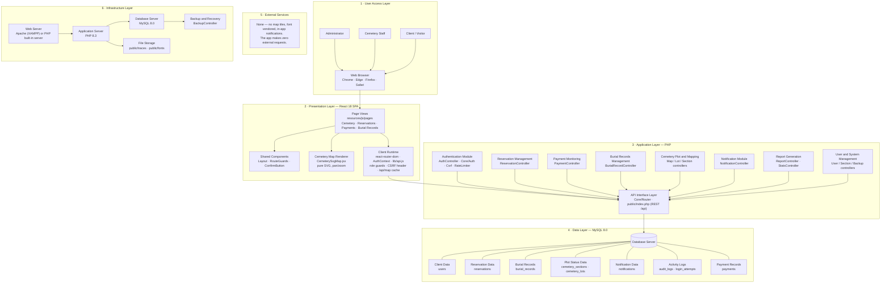

# System architecture

A reconciliation of the study's layered architecture diagram with the system as
built. The layers and application modules match; the differences are called out
under [Deviations from the study diagram](#deviations-from-the-study-diagram).

## Layers

## Presentation layer (what runs in the browser)

The presentation layer is the React single-page app served from `public/dist`.
It holds no business rules — it renders state and forwards intent — and it is the
layer the user never sees as "code", only as screens.

| Piece | Where | Responsibility |
| --- | --- | --- |
| Page views | `resources/js/pages/` | One component per screen; 15 routes, lazy-loaded so the public map does not carry the admin editors |
| Shared components | `resources/js/components/` | `Layout` (sidebar, nav), `RouteGuards`, `ConfirmButton`, `EmptyState`, `Loading`, `PasswordInput` |
| Map renderer | `CemeterySvgMap.jsx` | Draws the survey as SVG; pan/zoom, status colouring, plot selection |
| Client runtime | `react-router-dom`, `AuthContext`, `lib/api.js` | Client-side routing, session state, role-based route guards, the `X-CSRF-Token` header, and the per-session `/api/map` cache |

## Data model

| Study datastore | Table(s) |
| --- | --- |
| Client data | `users` |
| Reservation data | `reservations` |
| Payment records | `payments` |
| Burial records | `burial_records` |
| Plot status data | `cemetery_sections`, `cemetery_lots` |
| Notification data | `notifications` |
| Activity logs | `audit_logs`, `login_attempts` |
| Report / backup data | none stored — reports are generated on demand and backups stream as a download |

`schema.sql` seeds the 66 numbered sections; `database/survey/lots.sql` (loaded by
`make map-data`) adds the traced plots and brings the set to **70 sections and
6,734 plots**, including two perimeter blocks, *North Strip A* and *North Strip B*.

## Deviations from the study diagram

- **The Administrator actor is added to the user access layer.** The study
  diagram lists only Client/Visitor and Cemetery Staff; the system's RBAC has
  three roles — `admin`, `staff`, `user` — with the administrator managing
  users, sections, lots, reports, and backup/restore.
- **External Services is empty.** There is no external integration: the map is
  pure SVG (no tiles), the only font is vendored under `public/fonts`, and
  notifications are in-app. Payment is recorded manually, not through a gateway,
  so it needs no external service either. The layer exists but holds nothing.
- **File Storage is static assets only.** `public/traces` (map plan) and
  `public/fonts`; there is no user document store. Restore accepts an uploaded
  `.sql` file transiently and does not retain it.
- **Report / Backup data is not a datastore.** Reports are computed per request
  from the live tables; a backup is generated on demand through
  `BackupController` and downloaded, not persisted server-side.

## Infrastructure

The infrastructure chain matches the diagram: web server → PHP application →
MySQL, with file storage for static assets and backup/restore on the side. In
the containerized dev environment the web server is PHP's built-in server
(`php -S`) in front of the same front controller; under XAMPP it is Apache with
the `.htaccess` rewrites (see [../README.md](../README.md)).
